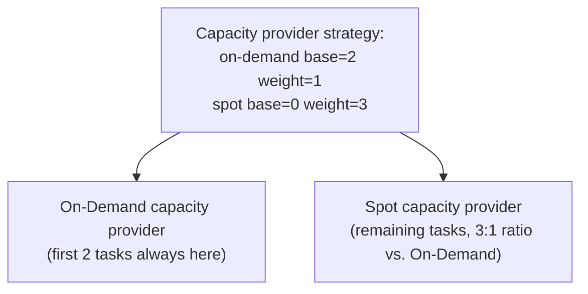

# ECS EC2 capacity: launch type vs. capacity providers

**Status:** CONFIRMED against AWS documentation (see References) for general mechanics. Specific default
values (step sizes, warm-up periods) are called out as ASSUMPTION/PENDING where AWS documents a default
that should be re-checked against the current console/CLI defaults before relying on it operationally.

## 1. Two ways to use EC2 capacity with ECS

There are two distinct ways to run EC2-launch-type tasks, and conflating them is a common source of
confusion:

| | **EC2 launch type (direct)** | **Capacity providers** |
|---|---|---|
| What you specify | `--launch-type EC2` on the service/task | `--capacity-provider-strategy` referencing one or more capacity providers |
| Who ensures enough EC2 capacity exists | You — manually, or your own ASG scaling policies | ECS, automatically, via **capacity provider managed scaling** |
| Cluster has registered container instances already? | Required — ECS only places onto what already exists | Not required upfront — the capacity provider can trigger the ASG to launch new instances on demand |
| Typical use | Simple or legacy setups, fixed-size capacity | Recommended default for EC2-backed ECS today |

**Key fact:** capacity providers are not a separate launch type — they are an automation layer *on top
of* the EC2 model. Whether you use a bare EC2 launch type or a capacity provider, the underlying unit of
capacity is still an EC2 instance registered as a container instance via the ECS agent
(`fundamentals.md`, §5). Capacity providers just automate *supplying* that capacity instead of you
managing an ASG's scaling policy by hand.

## 2. Why capacity providers exist

Without them, you must manually size and scale an ASG to match ECS workload demand — guessing ahead of
time, or wiring your own CloudWatch alarms on cluster-level CPU/memory reservation metrics. Capacity
providers close that loop: ECS itself watches how much CPU/memory its tasks need versus what the
cluster's registered instances have free, and adjusts the backing ASG's desired capacity accordingly.

## 3. Important components

- **Auto Scaling Group (ASG)** — the EC2-level construct that actually launches and terminates
  instances, from a launch template specifying AMI, instance type(s), instance profile role, and user
  data (which starts the ECS agent pointed at the right cluster).
- **Capacity provider** — an ECS resource that wraps a reference to one ASG and a managed-scaling
  configuration. A capacity provider is associated with exactly one ASG.
- **Capacity provider strategy** — set on a cluster (default) or a specific service/task (override):
  which capacity provider(s) to use, with relative `weight` and a `base` (minimum task count that must
  run on that provider before weight-based distribution applies). This is how you spread tasks across
  multiple capacity providers, e.g. an On-Demand provider and a Spot provider.
- **Managed scaling** — the capacity provider setting that lets ECS adjust the ASG's desired capacity
  automatically.
- **Managed termination protection** — the capacity provider setting that prevents the ASG from
  terminating an instance that is currently running tasks, during scale-in.
- **ECS cluster auto scaling** — the umbrella AWS term for this entire feature: one or more capacity
  providers, each with managed scaling, associated with a cluster via a capacity provider strategy.

## 4. How it works — managed scaling


ECS computes a `CapacityProviderReservation` value (roughly: how much of the cluster's registered
capacity is reserved by tasks, as a percentage, which can exceed 100% when more is needed than exists).
AWS manages the underlying CloudWatch alarms and scaling policy on your behalf — you do not configure
your own scaling policy on an ASG that a capacity provider manages this way; doing so risks the two
mechanisms fighting each other.

Scale-in works the same way in reverse: when reservation drops, ECS reduces the ASG's desired capacity —
which is exactly why **managed termination protection** matters (see §6): without it, the ASG's own
scale-in instance selection has no awareness of which instances are currently running tasks.

## 5. Practical example

Create a capacity provider backed by an existing ASG, then associate it with a cluster as the default
strategy:

```bash
aws ecs create-capacity-provider \
  --name <CAPACITY_PROVIDER_NAME> \
  --auto-scaling-group-provider \
      autoScalingGroupArn=<ASG_ARN>,\
managedScaling={status=ENABLED,targetCapacity=100,minimumScalingStepSize=1,maximumScalingStepSize=10},\
managedTerminationProtection=ENABLED
```

- `targetCapacity=100` — ECS tries to keep the ASG's capacity at ~100% utilized by reservation (i.e.
  scale out when more is needed, scale in when less is needed). A lower value (e.g. 80) keeps headroom
  for fast-starting new tasks at the cost of some idle capacity — confirm against current AWS guidance
  before choosing a value for a real workload (ASSUMPTION: no single value is universally "correct";
  it is a cost/responsiveness tradeoff).
- `minimumScalingStepSize` / `maximumScalingStepSize` — bounds on how many instances are added/removed
  per scaling action, to avoid both under-reacting and over-reacting to demand spikes.
- `managedTerminationProtection=ENABLED` — requires the ASG to have instance protection from scale-in
  enabled at the ASG level as well; confirm this prerequisite in the AWS documentation before enabling
  (PENDING verification against current API behavior if you rely on this).

```bash
aws ecs put-cluster-capacity-providers \
  --cluster <CLUSTER_NAME> \
  --capacity-providers <CAPACITY_PROVIDER_NAME> \
  --default-capacity-provider-strategy capacityProvider=<CAPACITY_PROVIDER_NAME>,weight=1,base=0
```

A service or task can then omit `--launch-type` entirely and simply rely on the cluster's default
capacity provider strategy, or override it per-service with its own `--capacity-provider-strategy`.

Check whether managed scaling is active and healthy:

```bash
aws ecs describe-capacity-providers --capacity-providers <CAPACITY_PROVIDER_NAME> \
  --query 'capacityProviders[0].{status:status,managedScaling:autoScalingGroupProvider.managedScaling}'
```

## 6. Managed termination protection — why it matters

**Scenario without it:** the ASG scales in (perhaps due to a scheduled scaling action, or because
someone also attached a separate scaling policy to the same ASG — see the mistake below). The ASG's
default termination policy has no concept of "this instance is running my tasks" — it can terminate an
instance mid-task, causing abrupt task disruption instead of a graceful drain.

**With managed termination protection enabled**, ECS participates in the ASG's scale-in decision: an
instance that is still running tasks is protected from termination until those tasks have been moved
elsewhere (see `instance-capacity-and-placement.md` §4, container instance draining) — scale-in becomes
graceful instead of abrupt.

## 7. ECS cluster auto scaling with multiple capacity providers

A cluster can have more than one capacity provider — e.g. one backed by an On-Demand ASG and one backed
by a Spot ASG, or different instance types for different workloads. The `base`/`weight` combination in
the capacity provider strategy controls distribution:

- `base` — an absolute minimum number of tasks that must run on a specific provider before any
  weight-based split applies. Useful for guaranteeing a floor of stable (e.g. On-Demand) capacity.
- `weight` — a relative ratio applied to tasks beyond each provider's base, across providers in the
  same strategy.



## 8. Common mistakes

- Attaching your own target-tracking or step scaling policy directly to an ASG that a capacity provider
  already manages — the two scaling mechanisms can conflict, each reacting to the other's changes.
- Enabling managed scaling but not managed termination protection, then being surprised when scale-in
  disrupts running tasks.
- Assuming a capacity provider "creates a cluster's EC2 instances" at creation time — it does not launch
  anything until ECS actually needs more capacity than is currently registered; an idle cluster with a
  capacity provider attached but zero task demand can still have zero running instances if the ASG's own
  minimum size is 0.
- Mixing `--launch-type EC2` and `--capacity-provider-strategy` on the same service/task — these are
  mutually exclusive; a service uses one model or the other.

## 9. Troubleshooting (pointer only)

Full runbooks ("ASG failing to launch EC2 instances," "cluster not receiving new EC2 capacity") are
planned for Phase 5. As a general approach when expected scale-out isn't happening: confirm managed
scaling `status` is `ENABLED` on the capacity provider first; then check the ASG's own `MaxSize` and
current `DesiredCapacity` (ECS cannot scale an ASG past its configured maximum); then check EC2-level
constraints (service quotas, subnet IP exhaustion, launch template validity) — these are three
independent layers, and a scale-out failure can originate in any of them.

## 10. Security considerations

- The ASG launch template's IAM instance profile role is what the ECS agent uses to register — keep it
  scoped to only what the agent and running tasks need (see `core/standards/aws-security.md`; full
  role breakdown in `core/patterns/aws/ecs/iam-roles-and-permissions.md`).
- Capacity provider and ASG names are visible in CloudTrail; follow `core/standards/naming-conventions.md`
  for consistent, auditable naming.

## 11. References

- Amazon ECS capacity providers: https://docs.aws.amazon.com/AmazonECS/latest/developerguide/cluster-capacity-providers.html
- Amazon ECS cluster auto scaling: https://docs.aws.amazon.com/AmazonECS/latest/developerguide/cluster-auto-scaling.html
- Capacity provider managed scaling: https://docs.aws.amazon.com/AmazonECS/latest/developerguide/asg-capacity-providers.html
- Managed termination protection: https://docs.aws.amazon.com/AmazonECS/latest/developerguide/asg-capacity-providers.html#asg-capacity-providers-termination-protection
- Amazon EC2 Auto Scaling: https://docs.aws.amazon.com/autoscaling/ec2/userguide/what-is-amazon-ec2-auto-scaling.html

## Related documents

- `fundamentals.md` — what a cluster and container instance are, and why creating a cluster alone creates no capacity.
- `instance-capacity-and-placement.md` — once capacity exists, how tasks are placed onto it and how draining works during scale-in.
- `core/standards/aws-security.md` — IAM and network security for the EC2 data plane.
