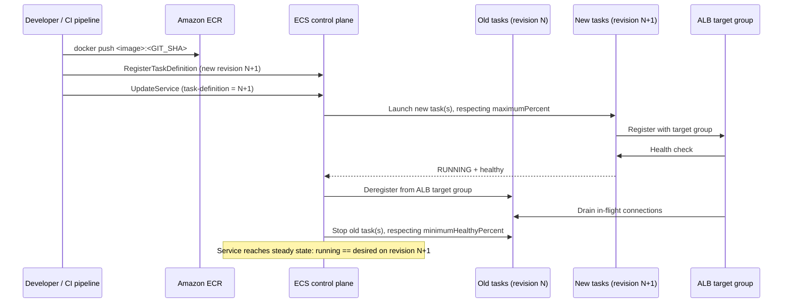

# ECS on EC2 — deployment

**Status:** CONFIRMED against AWS/GitHub documentation for the rolling-update (`ECS` controller) path
and the deployment circuit breaker (see References). Native ECS blue/green deployments (§8) is a newer
AWS capability — the concepts described are confirmed, but exact CLI/console enablement flags should be
re-verified against current AWS documentation before use, since this feature area has changed
recently (marked PENDING below).

## 1. Purpose

Walk through what actually happens, step by step, when you deploy a new version of a service — from
building an image through the old tasks being terminated — and explain the knobs that control how safe
or risky that process is (`minimumHealthyPercent`, `maximumPercent`, the deployment circuit breaker).
Also covers a sanitized GitHub Actions OIDC deployment workflow.

## 2. Prerequisites

- Read `fundamentals.md`, `task-definitions.md`, and `iam-roles-and-permissions.md` §8 (deployment role)
  first.
- Read `core/standards/deployment-standards.md` for the general (non-ECS-specific) deployment safety
  standard this document specializes.

## 3. How an ECS deployment works, start to finish



In words:
1. A new image is built and pushed to ECR with an immutable tag (`core/standards/naming-conventions.md`).
2. A new task definition **revision** is registered referencing that image (`task-definitions.md` §16).
3. The service is updated to point at the new revision (`UpdateService`).
4. The scheduler launches new tasks, places them on available EC2 capacity
   (`instance-capacity-and-placement.md`), and registers them with the ALB target group once `RUNNING`.
5. The ALB health-checks the new tasks; once enough are healthy, traffic shifts to them and old tasks are
   deregistered from the target group, drained, then stopped.
6. The service reaches steady state when `runningCount == desiredCount` on the new revision
   (`fundamentals.md` §6).

## 4. Rolling deployment configuration: `minimumHealthyPercent` and `maximumPercent`

These two settings, both expressed as a percentage of the service's desired count, control how
aggressively the rolling update proceeds:

- **`minimumHealthyPercent`** — the lower bound on healthy/running tasks allowed during the deployment
  (rounded up). Example: desired count 4, `minimumHealthyPercent=50` → the scheduler can stop up to 2
  existing tasks before starting 2 new ones.
- **`maximumPercent`** — the upper bound on total tasks allowed during the deployment (rounded down).
  Example: desired count 4, `maximumPercent=200` → the scheduler can start up to 4 new tasks *before*
  stopping any old ones (a full parallel rollout).

**Important, confirmed constraint:** you must leave room for the scheduler to actually stop or start at
least one task — a combination where the rounded minimum and maximum both equal the desired count
leaves no room to maneuver, and ECS reports a stuck-deployment service event rather than silently
succeeding.

```bash
aws ecs update-service \
  --cluster <CLUSTER_NAME> \
  --service <SERVICE_NAME> \
  --task-definition <TASK_DEF_FAMILY>:<NEW_REVISION> \
  --deployment-configuration "minimumHealthyPercent=100,maximumPercent=200"
```

`minimumHealthyPercent=100` keeps full capacity throughout (never fewer healthy tasks than desired);
`maximumPercent=200` allows doubling capacity temporarily to do so — this combination requires enough
EC2 capacity to actually host double the task count simultaneously, which ties back to
`capacity-providers.md`.

## 5. Deployment circuit breaker and automatic rollback

The circuit breaker detects a failing rolling deployment and can automatically roll back, without
anyone having to notice and intervene manually:

```bash
aws ecs create-service \
  --service-name <SERVICE_NAME> \
  --cluster <CLUSTER_NAME> \
  --task-definition <TASK_DEF_FAMILY>:<REVISION> \
  --desired-count 3 \
  --deployment-controller type=ECS \
  --deployment-configuration "deploymentCircuitBreaker={enable=true,rollback=true}"
```

- Only supported with the `ECS` (rolling update) deployment controller — not `CODE_DEPLOY` or `EXTERNAL`.
- It tracks failures in two stages: (1) tasks that never reach `RUNNING`, and (2) tasks that reach
  `RUNNING` but then fail their health checks (ALB, Cloud Map, or container health check). When the
  failure count hits a threshold (by default, a bounded percentage of desired count — AWS documents
  additional tuning via `resetOnHealthyTask` and `thresholdConfiguration`; verify current default
  behavior before relying on specific numbers, since AWS has refined this over time), the deployment is
  marked `FAILED`.
- With `rollback=true`, ECS automatically starts a new deployment back to the most recent `COMPLETED`
  deployment — i.e. the last known-good revision. **If no prior deployment is in a `COMPLETED` state
  (e.g. the very first deployment of a service fails), there is nothing to roll back to, and the service
  simply stays failed** — this is a real limitation to plan around for a brand-new service's first
  deployment.
- Check rollout status with `DescribeServices`'s `rolloutState`/`rolloutStateReason` fields, and consider
  an EventBridge rule on `SERVICE_DEPLOYMENT_FAILED` events so a failed deployment doesn't go unnoticed
  (per `core/standards/deployment-standards.md` on verification).

## 6. Deployment controller types

| Controller | How it works | When to use |
|---|---|---|
| `ECS` (rolling update) | Replaces tasks gradually in place, governed by §4's percentages; supports the circuit breaker (§5) | Default choice; simplest, no extra AWS resources needed |
| `CODE_DEPLOY` (blue/green via CodeDeploy) | Creates a second, parallel task set on a new ALB listener/target group; CodeDeploy shifts traffic once validated, keeping the old set running until confirmed | When you want a tested, mature blue/green mechanism integrated with CodeDeploy's traffic-shifting and rollback features |
| `EXTERNAL` | ECS does not manage task replacement at all — you (or a third-party tool) create and manage task sets directly | Custom/advanced deployment logic beyond what ECS or CodeDeploy provide |

## 7. ALB integration during a deployment

- `ECS`-controller rolling deployments use a single target group; new tasks register into it as they
  become healthy, old tasks deregister and drain as they're replaced (§3's sequence diagram).
- `CODE_DEPLOY`-controller blue/green deployments use **two** target groups behind the same ALB (or two
  listeners) — CodeDeploy shifts the listener's forwarding rule from the old target group to the new one
  once the new task set is validated, rather than mixing old and new tasks in one target group at once.
- In both cases, the target group's own health check (`networking.md` §8) — not just the task
  definition's container health check — gates whether a new task is considered ready to receive
  production traffic.

## 8. Native ECS blue/green deployments (PENDING — verify current specifics before use)

AWS has introduced a blue/green deployment capability built into ECS itself (distinct from the older
`CODE_DEPLOY` controller, which delegates to the separate CodeDeploy service). Confirmed terminology and
mechanics from AWS documentation:

- **Blue deployment** — the current production service revision. **Green deployment** — the new
  revision being validated.
- **Bake time** — a period after traffic shifts to green where both revisions keep running, so you can
  roll back quickly if something's wrong before the blue revision is torn down.
- **Lifecycle hooks** — pause points (or Lambda invocations) at specific stages (e.g. "after production
  traffic shift") for automated validation before the deployment proceeds further.
- For a load-balanced service, ECS manages the traffic shift between blue and green automatically; for a
  "headless" service (no load balancer), ECS replaces tasks without managing traffic shifting itself.

The exact CLI/console flags to opt a service into this deployment type, and how it differs operationally
from the `CODE_DEPLOY` controller in practice, are **not verified in this document** — confirm against
current AWS documentation before using it for a real service, since this is a newer and still-evolving
capability.

## 9. GitHub Actions OIDC deployment workflow

Full IAM role requirements are in `iam-roles-and-permissions.md` §8. The workflow itself, using
confirmed GitHub Actions for ECR/ECS plus OIDC federation instead of long-lived access keys:

```yaml
name: Deploy to ECS
on:
  push:
    branches: [main]

permissions:
  id-token: write   # required to request the OIDC JWT
  contents: read

jobs:
  deploy:
    runs-on: ubuntu-latest
    environment: production   # required reviewers / protected environment
    steps:
      - uses: actions/checkout@v4

      - name: Configure AWS credentials (OIDC)
        uses: aws-actions/configure-aws-credentials@v4
        with:
          role-to-assume: <DEPLOYMENT_ROLE_ARN>
          aws-region: <AWS_REGION>

      - name: Log in to Amazon ECR
        id: ecr-login
        uses: aws-actions/amazon-ecr-login@v2

      - name: Build and push image
        env:
          ECR_REGISTRY: ${{ steps.ecr-login.outputs.registry }}
          IMAGE_TAG: ${{ github.sha }}
        run: |
          docker build -t "$ECR_REGISTRY/<project>-<component>:$IMAGE_TAG" .
          docker push "$ECR_REGISTRY/<project>-<component>:$IMAGE_TAG"

      - name: Render new task definition
        id: render
        uses: aws-actions/amazon-ecs-render-task-definition@v1
        with:
          task-definition: <TASK_DEFINITION_FILE>.json
          container-name: api
          image: ${{ steps.ecr-login.outputs.registry }}/<project>-<component>:${{ github.sha }}

      - name: Deploy to ECS
        uses: aws-actions/amazon-ecs-deploy-task-definition@v2
        with:
          task-definition: ${{ steps.render.outputs.task-definition }}
          service: <SERVICE_NAME>
          cluster: <CLUSTER_NAME>
          wait-for-service-stability: true
```

- `permissions.id-token: write` is required for the OIDC token exchange (`iam-roles-and-permissions.md`
  §8) — omitting it causes `configure-aws-credentials` to fail requesting a token, before anything AWS
  related even runs.
- `environment: production` ties into GitHub's required-reviewers feature for the approval gate called
  for in `core/standards/deployment-standards.md` §Production change approval.
- `wait-for-service-stability: true` makes the workflow step itself fail if the service doesn't reach
  steady state — surfacing a bad deployment in CI rather than leaving it to be noticed later, consistent
  with `core/standards/deployment-standards.md` §Deployment verification.

## 10. Common deployment failures

| Symptom | Likely cause | Where to look |
|---|---|---|
| Deployment stuck, `rolloutState` stays `IN_PROGRESS` | New tasks can't reach `RUNNING` — capacity shortage or placement failure | `instance-capacity-and-placement.md` §6 |
| Deployment stuck, service event about `minimumHealthyPercent`/`maximumPercent` | The configured percentages leave no room for the scheduler to start or stop a task (§4) | Deployment configuration values vs. desired count |
| Circuit breaker rolled back immediately, every time | New revision's container fails health checks or its image can't be pulled | `aws ecs describe-tasks ... --query 'tasks[0].stoppedReason'`; `iam-roles-and-permissions.md` §4 (execution role) |
| Circuit breaker enabled but deployment just stays failed, no rollback happened | No prior `COMPLETED` deployment exists to roll back to (§5) — common on a brand-new service's first deploy | `DescribeServices` deployment history |
| New tasks `RUNNING` but ALB never sends them traffic | Target group health check misconfigured, or wrong target type for the network mode | `networking.md` §8–§9 |
| CI pipeline fails before touching ECS at all | OIDC trust policy condition doesn't match the actual repo/branch, or missing `id-token: write` | `iam-roles-and-permissions.md` §8; workflow `permissions` block |

## 11. Common mistakes

- Setting `maximumPercent=100` for a service that also wants zero-downtime deploys — this forces
  old tasks to stop before any new one starts, guaranteeing a capacity dip.
- Enabling the deployment circuit breaker without also setting up any alerting on
  `SERVICE_DEPLOYMENT_FAILED` — a failed, rolled-back deployment is silent unless you're watching for it.
- Using the `CODE_DEPLOY` controller but assuming it behaves like the `ECS` controller's percentages —
  the two controllers use different mechanisms entirely (§6).
- Granting the deployment role (`iam-roles-and-permissions.md` §8) more than `RegisterTaskDefinition`,
  `UpdateService`, and the specific `PassRole` targets it needs "to be safe" — this is the opposite of
  least privilege.

## 12. Security considerations

- The deployment role's required permissions are documented in full in `iam-roles-and-permissions.md`
  §8 — do not duplicate or widen them here.
- Require a protected GitHub environment with required reviewers for production deploys, per
  `core/standards/deployment-standards.md` §Production change approval.
- Never let the pipeline print the OIDC token, AWS credentials, or secret values to workflow logs.

## 13. References

- ECS rolling deployments (`minimumHealthyPercent`/`maximumPercent`): https://docs.aws.amazon.com/AmazonECS/latest/developerguide/deployment-type-ecs.html
- ECS deployment circuit breaker: https://docs.aws.amazon.com/AmazonECS/latest/developerguide/deployment-circuit-breaker.html
- ECS deployment types overview: https://docs.aws.amazon.com/AmazonECS/latest/developerguide/deployment-types.html
- ECS blue/green deployments: https://docs.aws.amazon.com/AmazonECS/latest/developerguide/deployment-type-blue-green.html
- Configuring OpenID Connect in Amazon Web Services (GitHub): https://docs.github.com/en/actions/security-for-github-actions/security-hardening-your-deployments/configuring-openid-connect-in-amazon-web-services
- Deploying to Amazon ECS (GitHub Actions): https://docs.github.com/en/actions/use-cases-and-examples/deploying/deploying-to-amazon-elastic-container-service

## Related documents

- `task-definitions.md` — registering the new revision being deployed.
- `iam-roles-and-permissions.md` §8 — the deployment role's exact permissions.
- `networking.md` §8 — target groups and health checks referenced during rollout.
- `core/standards/deployment-standards.md` — the general deployment safety standard this specializes.
