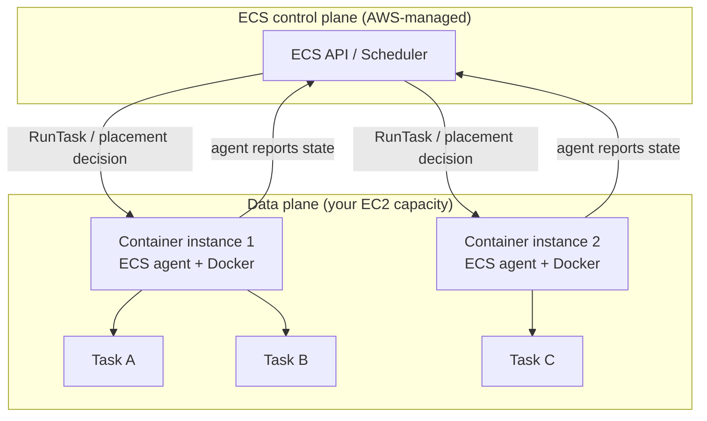
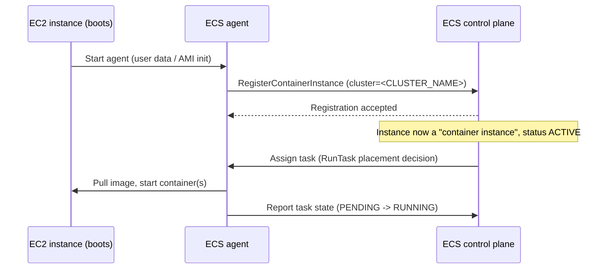

# ECS fundamentals (EC2 capacity model)

**Status:** CONFIRMED against AWS documentation (see References). Examples use placeholders only.

## 1. What is Amazon ECS?

Amazon Elastic Container Service (ECS) is a container orchestration service: it decides *where* your
containers run, keeps the requested number running, replaces ones that fail, and connects them to load
balancers, service discovery, and logging. You describe what you want (a task definition, a desired
count); ECS's scheduler continuously reconciles the actual state toward that desired state.

ECS does not run containers directly on its own hardware in the EC2 model — it schedules them onto EC2
instances that you (or an automated capacity provider, see `capacity-providers.md`) have registered into
a cluster. This is the key fact that distinguishes the EC2 launch type from Fargate: **in the EC2 model,
ECS is the scheduler, not the compute.**

## 2. Why do we need it?

Without an orchestrator, running containers reliably at scale requires manually deciding which host runs
which container, restarting failed containers, wiring up load balancer registration, and coordinating
rolling updates. ECS automates all of that for workloads running on AWS, while staying lighter-weight
and more AWS-native than running your own Kubernetes control plane.

## 3. Core building blocks

| Concept | What it is |
|---|---|
| **Cluster** | A logical grouping/namespace for services, tasks, and (in the EC2 model) the EC2 capacity that runs them. **Creating a cluster does not create any EC2 instances** — a cluster with zero registered container instances is valid and simply cannot run EC2-launch-type tasks until capacity is added. |
| **Container instance** | An EC2 instance that has been registered into an ECS cluster by the ECS agent running on it. Only registered, `ACTIVE` container instances can receive tasks. |
| **Task definition** | A versioned JSON blueprint: which container image(s) to run, CPU/memory, port mappings, environment variables, IAM roles, logging, volumes. Each change creates a new **revision**; the family name stays stable (e.g. `<project>-api-prod:7`). |
| **Task** | One running (or stopped) instantiation of a task definition — one or more containers scheduled together onto a single container instance. |
| **Service** | Keeps a specified number of tasks of a given task definition running continuously, replacing failed tasks and handling rolling deployments. Not all tasks need a service — one-off or scheduled work can run as a standalone task (e.g. via `RunTask` or EventBridge Scheduler). |
| **Container** | A single running process inside a task, defined by one container definition inside the task definition. A task can contain multiple containers (e.g. an app container plus a logging sidecar). |

## 4. Control plane vs. data plane

- **Control plane** — the ECS API and scheduler, fully managed by AWS. This is what you call via the
  CLI/SDK/console (`CreateCluster`, `RunTask`, `UpdateService`, etc.) and what makes placement decisions.
  You never manage control-plane infrastructure.
- **Data plane** — in the EC2 model, this is the EC2 instances that actually run your containers,
  plus the ECS agent and Docker (or containerd) runtime on each instance. **You are responsible for the
  data plane**: patching, scaling, and securing those EC2 instances (directly, or via a capacity
  provider automating it for you — see `capacity-providers.md`).



## 5. The ECS agent and container instance registration

The **ECS agent** is a small process AWS provides that runs on every EC2 instance you want to use as
ECS capacity (pre-installed on Amazon ECS-optimized AMIs; installable on other AMIs). On startup, the
agent:

1. Reads the cluster name from `/etc/ecs/ecs.config` (or equivalent user-data) on the instance.
2. Calls the ECS `RegisterContainerInstance` API on your behalf, using the EC2 instance profile role's
   credentials (see `core/patterns/aws/ecs/iam-roles-and-permissions.md`).
3. Reports available CPU/memory, launches tasks the scheduler assigns, and continuously reports task and
   instance health back to the ECS control plane.

An EC2 instance with no ECS agent running, or an agent that can't reach the ECS API, never becomes a
container instance — it simply doesn't show up in `list-container-instances`, and the cluster has no
usable capacity on it.



## 6. Service desired count, running count, pending count — and how this differs from ASG desired capacity

These are frequently confused because they all use the word "desired," but they live at different layers:

| Term | Layer | Meaning |
|---|---|---|
| **Service desired count** | ECS service | How many task instances you've told the service to keep running. You set this; ECS tries to maintain it. |
| **Service running count** | ECS service | How many tasks are currently in the `RUNNING` state for that service, right now. |
| **Service pending count** | ECS service | How many tasks are currently starting (placed, but not yet `RUNNING` — pulling images, passing health checks, etc.). |
| **ASG desired capacity** | EC2 Auto Scaling Group | How many **EC2 instances** the Auto Scaling Group is trying to keep running. This is a completely separate number from any ECS service's desired count, and nothing automatically keeps them in sync unless you use capacity providers with managed scaling (see `capacity-providers.md`). |

**Why the distinction matters:** a service can be stuck with `runningCount` below `desiredCount` for two
very different classes of reason — (a) the *tasks* aren't starting (image pull failure, health check
failure, bad task definition) — a data-plane application problem — or (b) there isn't enough *EC2
capacity* for the scheduler to place the task at all — a capacity problem, which is where ASG desired
capacity becomes relevant. Checking both independently is necessary; do not assume one explains the
other.

## 7. Practical example

A generic web service, assuming a cluster and capacity already exist (see `capacity-providers.md` for
how capacity is actually provisioned):

```bash
# Create the cluster (a namespace only — no EC2 instances yet)
aws ecs create-cluster --cluster-name <CLUSTER_NAME>

# Confirm it exists and has zero registered instances so far
aws ecs describe-clusters --clusters <CLUSTER_NAME> \
  --query 'clusters[0].{name:clusterName,registeredInstances:registeredContainerInstancesCount,activeServices:activeServicesCount}'
```

Expected output immediately after creation — `registeredInstances` is `0` because creating a cluster
never creates EC2 capacity:

```json
{
    "name": "<CLUSTER_NAME>",
    "registeredInstances": 0,
    "activeServices": 0
}
```

Once capacity exists (container instances registered), create a service from a task definition:

```bash
aws ecs create-service \
  --cluster <CLUSTER_NAME> \
  --service-name <SERVICE_NAME> \
  --task-definition <TASK_DEF_FAMILY>:<REVISION> \
  --desired-count 2 \
  --launch-type EC2
```

- `--task-definition <family>:<revision>` — pin to a specific revision rather than only the family, so
  the exact deployed definition is unambiguous and traceable (see `core/standards/naming-conventions.md`).
- `--desired-count 2` — the service-level desired count discussed above.
- `--launch-type EC2` — explicitly requests EC2 capacity selection without a capacity provider strategy.
  (Contrast with `capacityProviderStrategy`, covered in `capacity-providers.md` — a service uses one or
  the other, not both.)

Check the three counts together:

```bash
aws ecs describe-services --cluster <CLUSTER_NAME> --services <SERVICE_NAME> \
  --query 'services[0].{desired:desiredCount,running:runningCount,pending:pendingCount}'
```

```json
{
    "desired": 2,
    "running": 2,
    "pending": 0
}
```

`running == desired` and `pending == 0` is the healthy steady state. Anything else persisting for more
than a few minutes is worth investigating (see the troubleshooting pointer below and the dedicated
runbooks planned for Phase 5).

## 8. Common mistakes

- Assuming `create-cluster` provisions compute — it only creates the logical grouping. No EC2 instances,
  no capacity, no cost beyond the (free) cluster resource itself.
- Confusing a task definition **family** (stable name) with a specific **revision** (immutable snapshot)
  — deploying "the task definition" without pinning a revision number makes it unclear which exact
  configuration is running.
- Treating `runningCount < desiredCount` as always meaning "ECS is broken." It is frequently a capacity
  or application-health problem one layer down, not an ECS control-plane problem.
- Forgetting that a task can have multiple containers — "the task is unhealthy" can mean one specific
  container within it, not the whole task uniformly.

## 9. Troubleshooting (pointer only)

This document explains concepts, not step-by-step diagnosis — dedicated runbooks for "service unable to
reach desired count," "tasks stuck in PENDING," and similar are planned for Phase 5. As a general
approach: check service-level counts first (§6/§7), then check container-instance-level resource
availability and placement (see `instance-capacity-and-placement.md`), then check the individual task's
stopped reason (`aws ecs describe-tasks ... --query 'tasks[0].stoppedReason'`) if a task keeps exiting.
Do not assume a single root cause before checking at least these three layers.

## 10. Security considerations

- The ECS agent registers instances using the **EC2 instance profile role**'s credentials — scope that
  role narrowly (see `core/standards/aws-security.md`); the full task-execution-role vs. task-role vs.
  instance-profile-role breakdown is in `core/patterns/aws/ecs/iam-roles-and-permissions.md`.
- Cluster names, service names, and task definition families are visible in CloudTrail and billing data
  — avoid encoding sensitive information into them (see `core/standards/aws-security.md` §Auditability).

## 11. References

- What is Amazon ECS: https://docs.aws.amazon.com/AmazonECS/latest/developerguide/Welcome.html
- Amazon ECS clusters: https://docs.aws.amazon.com/AmazonECS/latest/developerguide/clusters.html
- Amazon ECS task definitions: https://docs.aws.amazon.com/AmazonECS/latest/developerguide/task_definitions.html
- Amazon ECS services: https://docs.aws.amazon.com/AmazonECS/latest/developerguide/ecs_services.html
- Amazon ECS container agent: https://docs.aws.amazon.com/AmazonECS/latest/developerguide/ecs-agent.html
- Amazon ECS container instances: https://docs.aws.amazon.com/AmazonECS/latest/developerguide/ecs_instances.html

## Related documents

- `capacity-providers.md` — how EC2 capacity backing a cluster is actually supplied and scaled.
- `instance-capacity-and-placement.md` — how the scheduler decides *which* container instance a task lands on.
- `core/standards/naming-conventions.md` — naming pattern used in the examples above.
