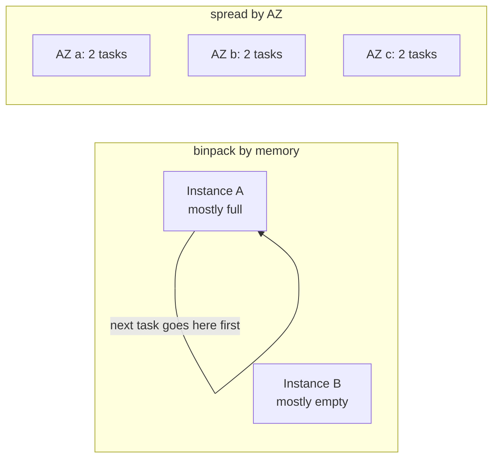
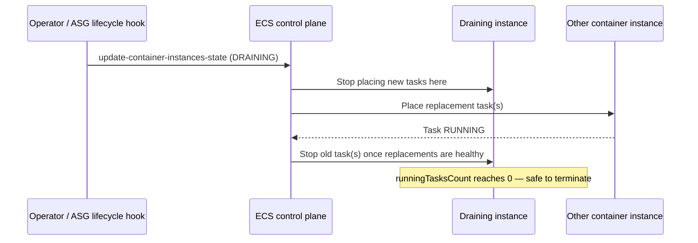

# ECS EC2 instance capacity, task placement, and draining

**Status:** CONFIRMED against AWS documentation (see References) for general mechanics. Numeric
examples (instance sizes, reserved overhead) are illustrative, not measured values — verify actual
reserved memory/CPU for a specific AMI/instance type before using it for real capacity planning.

## 1. EC2 instance type selection and resource capacity

Each container instance advertises **registered resources** (total CPU units and memory available for
tasks) and **remaining resources** (what's currently unused) to the ECS scheduler. Choosing an instance
type is really choosing how much registered CPU/memory each container instance contributes to the pool.

Practical considerations:

- The OS, the ECS agent, and (for some configurations) the Docker/containerd runtime reserve some memory
  for themselves — the memory ECS reports as available to tasks is lower than the instance's advertised
  RAM. Always check actual registered resources via the API rather than assuming "a 4 GiB instance gives
  tasks 4 GiB" (ASSUMPTION flagged: exact reserved amount varies by AMI and configuration — verify per
  instance type before capacity planning).
- Fewer, larger instances **bin-pack** more efficiently (less wasted fragmented capacity) but create a
  larger blast radius if one instance fails or is replaced. More, smaller instances spread risk but
  waste more capacity to fixed per-instance overhead and may hit per-instance ENI/port limits sooner for
  `bridge` or `host` networking tasks.
- A capacity provider strategy can mix instance types/ASGs (see `capacity-providers.md` §7) so you are
  not limited to one instance type per cluster.

Check what a specific container instance actually has available:

```bash
aws ecs describe-container-instances --cluster <CLUSTER_NAME> --container-instances <CONTAINER_INSTANCE_ARN> \
  --query 'containerInstances[0].{registered:registeredResources,remaining:remainingResources,runningTasks:runningTasksCount,status:status}'
```

Expected shape of output (values illustrative):

```json
{
    "registered": [
        {"name": "CPU", "integerValue": 2048},
        {"name": "MEMORY", "integerValue": 3768}
    ],
    "remaining": [
        {"name": "CPU", "integerValue": 1024},
        {"name": "MEMORY", "integerValue": 1768}
    ],
    "runningTasks": 2,
    "status": "ACTIVE"
}
```

## 2. CPU and memory reservation

ECS tracks CPU in **CPU units** (1 vCPU = 1024 units) and memory in **MiB**, at both the task level and
optionally per-container within the task.

| Setting | Level | Effect |
|---|---|---|
| Task `cpu` | Task definition | Used mainly for scheduling/accounting on EC2 (it's a soft guide for CPU share, not usually a hard cap on EC2 the way it is on Fargate). |
| Container `memory` (hard limit) | Container | A hard ceiling — the container is OOM-killed by the kernel if it exceeds this. |
| Container `memoryReservation` (soft limit) | Container | Used by the scheduler for **placement** (how much memory to reserve against the instance's remaining capacity) and by Docker for contention handling; the container can burst above this up to the hard limit if the instance has spare memory. |

**Why this matters for placement:** the scheduler decides whether a container instance *can* fit a new
task by comparing the task's memory reservation (and CPU) against that instance's remaining resources —
not against the hard limit. Under-setting `memoryReservation` can let the scheduler over-pack an
instance, which then risks real OOM kills under load even though "there was room" by the scheduler's
accounting.

## 3. Task placement strategies

A **placement strategy** tells the scheduler *how to choose* among container instances that are all
otherwise eligible (i.e. have enough remaining resources and satisfy any constraints). You can combine
multiple strategies as a priority-ordered list.

| Strategy | Behavior | Typical use |
|---|---|---|
| `binpack` | Place on the instance with the least remaining CPU or memory (your choice of field) that still fits | Minimize the number of instances in use, maximize utilization |
| `spread` | Place to even out tasks across a given field (e.g. `attribute:ecs.availability-zone`, or `instanceId`) | Maximize availability — avoid concentrating a service's tasks on one AZ or instance |
| `random` | Place on any eligible instance at random | Simple, low-overhead default when neither packing nor spreading matters much |



Example combining spread-then-binpack — spread across AZs first for availability, then pack tightly
within each AZ for efficiency:

```bash
aws ecs create-service \
  --cluster <CLUSTER_NAME> \
  --service-name <SERVICE_NAME> \
  --task-definition <TASK_DEF_FAMILY>:<REVISION> \
  --desired-count 6 \
  --placement-strategy field=attribute:ecs.availability-zone,type=spread field=memory,type=binpack
```

## 4. Task placement constraints

A **placement constraint** is a hard rule — eligible instances that don't satisfy it are excluded
entirely, rather than merely deprioritized.

| Constraint type | Behavior |
|---|---|
| `distinctInstance` | Every task in this request must land on a different container instance — no two replicas sharing a host. |
| `memberOf` | Only place on instances matching a cluster query expression against instance attributes (e.g. a specific instance type, or a custom attribute you've set). |

```bash
aws ecs create-service \
  --cluster <CLUSTER_NAME> \
  --service-name <SERVICE_NAME> \
  --task-definition <TASK_DEF_FAMILY>:<REVISION> \
  --desired-count 3 \
  --placement-constraints type=distinctInstance
```

**Failure mode to know:** `distinctInstance` with a desired count higher than the number of eligible
container instances cannot succeed — the scheduler will leave the excess tasks `PENDING` indefinitely
rather than relax the constraint. This is a placement-constraint problem, not a general capacity
shortage, even though the symptom (`pendingCount > 0`) looks identical to one — check constraints
*and* raw capacity independently.

## 5. Container instance draining

Before removing a container instance from service (scale-in, patching, replacing an unhealthy instance),
set its status to `DRAINING` so ECS reschedules its tasks elsewhere instead of killing them abruptly:

```bash
aws ecs update-container-instances-state \
  --cluster <CLUSTER_NAME> \
  --container-instances <CONTAINER_INSTANCE_ARN> \
  --status DRAINING
```

What happens next:
1. The instance stops being eligible for new task placement.
2. Services with tasks on that instance start new replacement tasks elsewhere (subject to normal
   placement strategies/constraints and available capacity — draining does not bypass capacity limits).
3. Once existing tasks have stopped (or the service's deployment configuration has moved them), the
   instance has `runningTasksCount == 0` and is safe to terminate.



This is exactly what **managed termination protection** (`capacity-providers.md` §6) automates during
ASG scale-in — you rarely need to call `update-container-instances-state` manually once that's
configured, but it's useful to understand (and to use directly) for manual maintenance, e.g. patching
one specific instance outside of any scaling event.

## 6. Common EC2 capacity problems

Do not assume a single root cause for "tasks won't start" — check each of these independently:

| Symptom | Possible cause | Where to check |
|---|---|---|
| Task stuck `PENDING`, placement failure reason mentions `RESOURCE:CPU` or `RESOURCE:MEMORY` | No container instance currently has enough free CPU/memory to fit the task | `describe-container-instances` remaining resources across the cluster |
| Task stuck `PENDING`, cluster has zero registered container instances | No EC2 capacity registered at all — ASG desired capacity is 0, or agents aren't registering | `list-container-instances`; ASG desired capacity; `fundamentals.md` §5 |
| Scheduler can't place despite the cluster *appearing* to have enough aggregate capacity | Capacity is fragmented — no *single* instance has enough free resources, even though the sum across instances does | Per-instance remaining resources, not just cluster totals |
| Placement constraint can't be satisfied | e.g. `distinctInstance` with desired count exceeding available distinct instances | Constraint definition vs. instance count |
| ASG won't scale out further | ASG `MaxSize` reached, or EC2-level limits (service quota, subnet IP exhaustion, launch template issue) | `describe-auto-scaling-groups`; EC2 service quotas |
| Capacity added but task still `PENDING` | New instance registered but agent not yet `ACTIVE`/connected, or instance type doesn't satisfy a placement constraint | `describe-container-instances` `agentConnected` and `status` fields |

```bash
# Why is this task not running?
aws ecs describe-tasks --cluster <CLUSTER_NAME> --tasks <TASK_ARN> \
  --query 'tasks[0].{lastStatus:lastStatus,stoppedReason:stoppedReason}'

# How much raw capacity exists right now?
aws ecs list-container-instances --cluster <CLUSTER_NAME> --query 'containerInstanceArns'
aws autoscaling describe-auto-scaling-groups --auto-scaling-group-names <ASG_NAME> \
  --query 'AutoScalingGroups[0].{desired:DesiredCapacity,min:MinSize,max:MaxSize}'
```

Dedicated step-by-step runbooks for these scenarios (with console steps, full diagnostic sequences, and
rollback considerations) are planned for Phase 5 — this section is a conceptual map of where to look,
not a replacement for those runbooks.

## 7. Common mistakes

- Reading only cluster-level aggregate CPU/memory and concluding "there's enough capacity" — placement
  needs a *single* instance with enough room; fragmented free capacity across many instances doesn't help.
- Using `distinctInstance` without checking it against the cluster's actual instance count.
- Terminating a container instance directly (without draining first) during routine maintenance,
  causing an abrupt task interruption that a `DRAINING` transition would have avoided.
- Setting container `memoryReservation` far below real usage "to fit more tasks," then being surprised
  by OOM kills once the instance is genuinely under memory pressure.

## 8. Security considerations

- Draining and placement decisions don't themselves carry security risk, but the instance profile role
  attached to new capacity (launched by the ASG) must still follow least privilege — see
  `core/standards/aws-security.md`.
- Custom instance attributes used in `memberOf` constraints are visible via the ECS API; avoid encoding
  sensitive information into them.

## 9. References

- Amazon ECS container instances: https://docs.aws.amazon.com/AmazonECS/latest/developerguide/ecs_instances.html
- Amazon ECS task placement strategies: https://docs.aws.amazon.com/AmazonECS/latest/developerguide/task-placement-strategies.html
- Amazon ECS task placement constraints: https://docs.aws.amazon.com/AmazonECS/latest/developerguide/task-placement-constraints.html
- Container instance draining: https://docs.aws.amazon.com/AmazonECS/latest/developerguide/container-instance-draining.html
- Task definition memory and CPU: https://docs.aws.amazon.com/AmazonECS/latest/developerguide/task-cpu-memory-error.html

## Related documents

- `fundamentals.md` — cluster, container instance, and task vocabulary assumed here.
- `capacity-providers.md` — how capacity is supplied and scaled before it can be placed onto.
- `core/standards/aws-security.md` — least-privilege instance profile roles.
