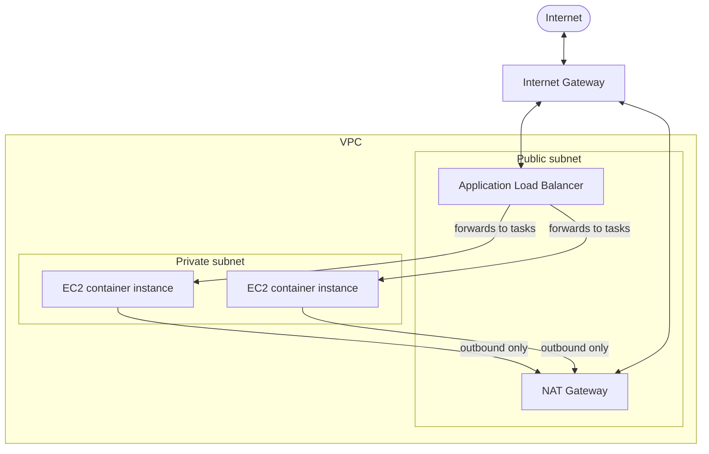
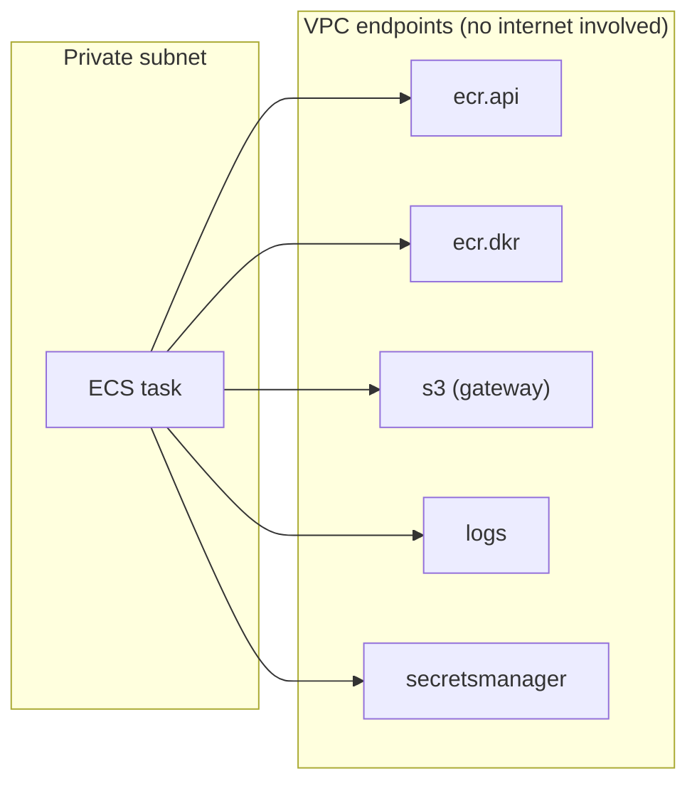
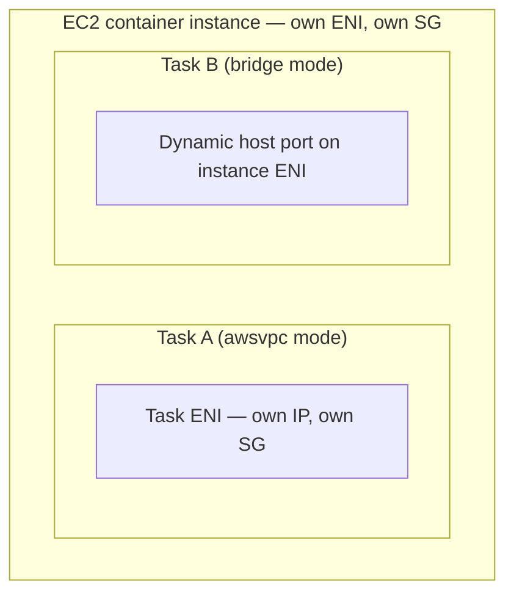
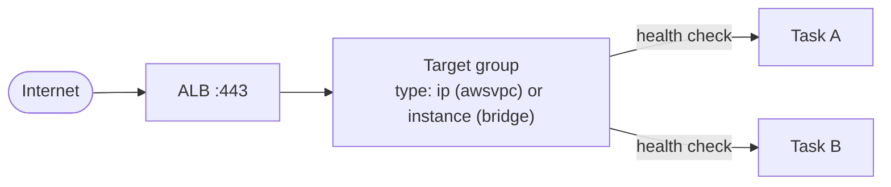

# ECS on EC2 — networking

**Status:** CONFIRMED against AWS documentation (see References). All CIDRs, resource names, and IDs
below are placeholders.

## 1. Purpose

Explain how network traffic actually reaches an ECS task running on EC2 — from the VPC layout down to
the specific ENI a task uses — and how that differs from the networking of the EC2 instance underneath
it. This is the piece that makes "why can't my task reach X" or "why isn't the ALB routing to my task"
answerable from first principles instead of guesswork.

## 2. Prerequisites

- Read `fundamentals.md` (container instance, task) and `task-definitions.md` §7 (port mappings) first
  — this document goes deeper into the networking modes introduced there.

## 3. VPC layout: public and private subnets

A typical production ECS-on-EC2 architecture splits a VPC into two subnet tiers:

| Tier | Contains | Default route |
|---|---|---|
| **Public subnet** | The ALB, a NAT Gateway | `0.0.0.0/0` → **Internet Gateway** |
| **Private subnet** | EC2 container instances (and the tasks on them) | `0.0.0.0/0` → **NAT Gateway** |

- **Internet Gateway (IGW)** — attached to the VPC, gives public subnets a route to/from the internet.
- **NAT Gateway** — sits in a public subnet; gives private-subnet resources outbound-only internet
  access (e.g. to call an external API) without being directly reachable from the internet.
- **Route tables** — one per subnet (or shared across subnets of the same tier), controlling which
  gateway traffic from that subnet is sent to. The public/private distinction is actually *defined* by
  the route table, not by any special subnet property — a subnet is "public" because its route table
  sends `0.0.0.0/0` to an IGW, and "private" because it doesn't.

Putting container instances in a private subnet means nothing on the internet can initiate a connection
directly to them — all inbound traffic must come through the ALB.

## 4. Security groups

A security group is a stateful virtual firewall attached to an ENI (not to a subnet). In this
architecture there are typically at least two distinct security groups:

| Security group | Attached to | Typical inbound rule |
|---|---|---|
| ALB security group | The ALB's ENIs | Allow `443`/`80` from `0.0.0.0/0` (or a narrower known range) |
| Task/instance security group | The EC2 instance (and, in `awsvpc` mode, the task's own ENI — see §7) | Allow the task's container port **only from the ALB security group** (a security-group-to-security-group reference, not a CIDR) |

Referencing the ALB's security group ID as the *source* of the task's inbound rule, instead of a CIDR
range, means the rule stays correct even if subnet ranges change later — see
`core/standards/aws-security.md`.

## 5. VPC endpoints — reaching AWS services without the internet

A private subnet's EC2 instances and tasks need to reach several AWS services even though they have no
direct internet route. Two options:

1. Route that traffic out through the NAT Gateway to the public AWS API endpoint (works, but traffic
   leaves the private network boundary and NAT Gateway data processing has a cost).
2. Use a **VPC endpoint** — a private, PrivateLink-backed connection from the VPC directly to the AWS
   service, with no NAT Gateway or internet path involved.

For ECS tasks on EC2 pulling private images from ECR, AWS documentation states you need **all three** of
the following endpoints in the private subnet's route table / security group scope:

| Endpoint | Type | Purpose |
|---|---|---|
| `com.amazonaws.<region>.ecr.api` | Interface | ECR API calls (e.g. `DescribeImages`) |
| `com.amazonaws.<region>.ecr.dkr` | Interface | Actual image pull/push (Docker registry protocol) |
| `com.amazonaws.<region>.s3` | Gateway | ECR stores image layers in S3 — pulling an image also pulls from this bucket |

CloudWatch Logs (`com.amazonaws.<region>.logs`, interface) and Secrets Manager
(`com.amazonaws.<region>.secretsmanager`, interface) endpoints follow the same pattern — add them when a
private subnet has no NAT Gateway and tasks use `awslogs` logging or `secrets` injection
(`task-definitions.md` §8, §10).

Interface endpoints each get their own ENI and security group (allow inbound `443` from the private
subnet); the S3 gateway endpoint instead attaches to the route table directly — no ENI, no security
group.

## 6. Network modes — awsvpc, bridge, host

Introduced in `task-definitions.md` §7; full behavior here:

| Mode | Each task gets its own ENI? | Host port behavior | Notes |
|---|---|---|---|
| `awsvpc` | **Yes** | N/A — `containerPort` only; mapped directly to the task's ENI | Recommended by AWS unless you have a specific reason not to use it. Gives the task the same networking properties as an EC2 instance — its own private IP, its own security group. |
| `bridge` | No — shares the instance's Docker bridge network | `hostPort` optional; omitted = dynamic (random high port assigned by Docker) | Default mode on Linux if unspecified. Dynamic host ports are what let multiple tasks from the same service run on one instance. |
| `host` | No — uses the instance's network namespace directly | `hostPort` must equal `containerPort` or be blank | No two tasks using the same host port can run on one instance at the same time — this rules out running multiple replicas of the same task definition on one instance. |

## 7. ENIs and task networking — how this differs from EC2 instance networking

This is the distinction most often missed:

- **The EC2 instance's own networking** — its own ENI, its own private IP, its own security group —
  governs traffic to the *instance itself* (SSH, the ECS agent's own traffic, Docker daemon).
- **In `awsvpc` mode, each task gets a *separate* ENI and IP address**, attached to the same subnet as
  the instance but logically independent. A security group applied to the task (via the service's
  network configuration) is enforced on the *task's* ENI, separately from whatever security group is on
  the instance itself.
- **In `bridge`/`host` mode, there is no separate task ENI** — the task's traffic is multiplexed through
  the instance's own networking, which is why dynamic host ports exist (to avoid port collisions between
  co-located tasks) and why the instance's security group is what actually governs task traffic in these
  modes.

## 8. ALB integration

Full deployment-time behavior is in `deployment.md`; the static architecture piece:

- An ALB routes to a **target group**, which has a **target type** — either `instance` (register by EC2
  instance ID + port) or `ip` (register by IP address + port).
- **`awsvpc`-mode tasks must use target type `ip`** — each task has its own IP (its own ENI, §7), so the
  target group registers that IP directly, not the underlying instance.
- **`bridge`-mode tasks typically use target type `instance`** combined with dynamic host port mapping —
  ECS registers the instance ID and whatever dynamic port Docker assigned for that task.
- The ALB continuously runs its own **target group health check** (HTTP path, interval, healthy/unhealthy
  thresholds) against each registered target, independent of any container-level `healthCheck` in the
  task definition (`task-definitions.md` §11) — a task can be `RUNNING` and pass its own container health
  check while still failing the ALB's target group health check (e.g. wrong health check path configured
  on the target group), so check both when a task isn't receiving traffic.

## 9. Common networking failures and how to identify them

| Symptom | Likely cause | How to check |
|---|---|---|
| ALB returns 503, no healthy targets | Target group health check path/port misconfigured, or security group doesn't allow ALB → task traffic | Target group health check tab in console; security group rules |
| Task can't pull image / can't reach Secrets Manager, no NAT Gateway in subnet | Missing VPC endpoint(s) (§5) | Check route table for NAT route, check VPC endpoints exist for ecr.api/ecr.dkr/s3/secretsmanager/logs as needed |
| Two tasks of the same service won't both start on one instance | `host` network mode with a fixed host port, or `bridge` mode with a manually fixed (non-dynamic) host port | Task definition `networkMode` and `hostPort` settings (`task-definitions.md` §7) |
| Task reachable from other tasks on the instance but not from the ALB | Security group on the task's ENI (awsvpc) or instance (bridge/host) doesn't allow the ALB's security group as a source | Compare the task/instance SG inbound rules against the ALB's SG ID |
| Everything looks correctly configured but intermittently fails to resolve AWS service hostnames | VPC endpoint created without private DNS enabled, or DNS resolution/hostnames disabled on the VPC | VPC endpoint "Private DNS name" setting; VPC `enableDnsHostnames`/`enableDnsSupport` attributes |

Do not assume one of these is "the" cause before checking — a 503 from the ALB in particular can stem
from either the security-group layer or the health-check-configuration layer, which require different
fixes.

## 10. Common mistakes

- Registering `awsvpc`-mode tasks with target type `instance` — this doesn't work; `awsvpc` tasks need
  `ip` target type since each task has its own IP, not the instance's.
- Scoping a task/instance security group's inbound rule to a CIDR range instead of the ALB's security
  group ID — works initially but becomes stale and harder to audit as the network evolves.
- Forgetting the S3 gateway endpoint when adding ECR interface endpoints — ECR image pulls fail partway
  through (metadata succeeds, layer download fails) because layers are stored in S3.
- Assuming a task's security group is the same as its instance's security group — true for `bridge`/
  `host` mode, false for `awsvpc` mode (§7).

## 11. Security considerations

- Keep container instances and tasks in private subnets; only the ALB (and a bastion/VPN if used) should
  be in a public subnet — see `core/standards/aws-security.md` §Network security.
- Prefer VPC endpoints over routing AWS-service traffic through a NAT Gateway and the public internet
  when the service supports them (§5).
- Use security-group-to-security-group references for ALB→task traffic, not CIDR ranges (§4).

## 12. References

- ECS task networking (EC2): https://docs.aws.amazon.com/AmazonECS/latest/developerguide/task-networking.html
- Use load balancing to distribute ECS service traffic: https://docs.aws.amazon.com/AmazonECS/latest/developerguide/service-load-balancing.html
- ALB target groups and target types: https://docs.aws.amazon.com/elasticloadbalancing/latest/application/load-balancer-target-groups.html
- ECR VPC endpoints: https://docs.aws.amazon.com/AmazonECR/latest/userguide/vpc-endpoints.html
- VPC endpoints (general): https://docs.aws.amazon.com/vpc/latest/privatelink/vpc-endpoints.html
- NAT gateways: https://docs.aws.amazon.com/vpc/latest/userguide/vpc-nat-gateway.html
- Internet gateways: https://docs.aws.amazon.com/vpc/latest/userguide/VPC_Internet_Gateway.html

## Related documents

- `fundamentals.md` — container instance and task vocabulary.
- `task-definitions.md` §7 — port mapping and network mode basics.
- `deployment.md` — how the ALB participates during a rolling deployment.
- `core/standards/aws-security.md` — network security standard this document applies to ECS specifically.
