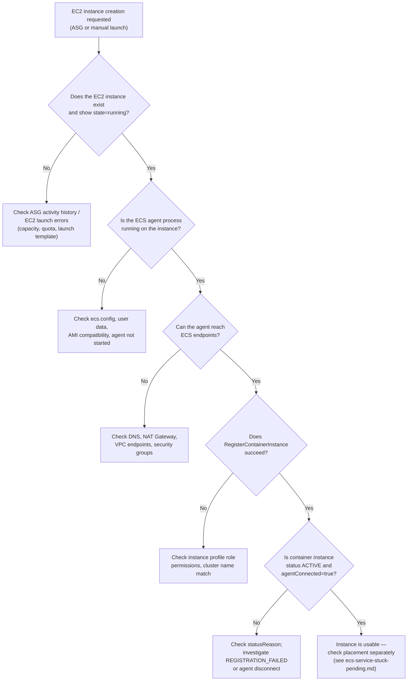

# Runbook: EC2 instance not registering with ECS cluster

## 1. Title and purpose

An EC2 instance was launched to provide capacity for an ECS cluster, but it never appears as a
container instance. This runbook walks through diagnosing **why**, since there are at least five
distinct failure points between "EC2 instance exists" and "ECS can place tasks on it" — this runbook
does not assume any single one of them is the cause.

## 2. Symptoms

- `aws ecs list-container-instances` never shows the new instance's ARN.
- The ECS console cluster page shows fewer container instances than EC2 instances you expect to be
  backing it.
- A service or capacity provider reports it cannot place tasks ("no container instance met all of its
  requirements") despite EC2 instances appearing to be running.

## 3. Possible root causes

Do not assume one of these explains the symptom — work through them in order (see the decision tree in
§6):

1. The EC2 instance was never actually created (ASG launch failure, insufficient EC2 capacity/quota).
2. The instance exists and is running, but the ECS agent process is not running on it.
3. The ECS agent is running but cannot reach the ECS control plane (network/DNS/endpoint problem).
4. The agent reaches ECS, but `RegisterContainerInstance` fails (IAM permissions, wrong cluster name).
5. The instance registers but never becomes usable for task placement (stuck `REGISTERING`,
   `REGISTRATION_FAILED`, or `agentConnected: false`).

## 4. Architecture context

Full background: `core/patterns/aws/ecs/fundamentals.md` §5 (ECS agent and registration flow) and
`core/patterns/aws/ecs/iam-roles-and-permissions.md` §6 (the EC2 container instance role). In short: the
ECS agent on the instance reads the target cluster name from `/etc/ecs/ecs.config`, then uses the
instance's IAM instance profile credentials to call `RegisterContainerInstance`. Any break in that
chain — the instance not existing, the agent not running, no network path to ECS, or missing IAM
permissions — produces the same visible symptom (instance absent from the cluster) for different reasons.

## 5. Prerequisites and required permissions

- Read-only IAM permissions: `ecs:ListContainerInstances`, `ecs:DescribeContainerInstances`,
  `ecs:DescribeClusters`, `ec2:DescribeInstances`, `ec2:DescribeInstanceStatus`.
- SSH or AWS Systems Manager Session Manager access to the instance, to read the agent log and config
  file (read-only — do not modify configuration as part of investigation; see §12).
- This runbook assumes the EC2 launch template/instance already has an instance profile attached — if it
  doesn't, see `core/patterns/aws/ecs/iam-roles-and-permissions.md` §6 for what that role needs.

## 6. Step-by-step investigation (decision tree)



### Step A — does the EC2 instance exist?

```bash
aws ec2 describe-instances \
  --instance-ids <instance-id> \
  --query 'Reservations[0].Instances[0].{State:State.Name,LaunchTime:LaunchTime,SubnetId:SubnetId}'
```

If this returns nothing or an error, the instance was never created, or was created and already
terminated. Check the Auto Scaling Group's activity history for launch failures (capacity shortage,
service quota limits, invalid launch template) — see
`core/patterns/aws/ecs/capacity-providers.md` §9. This runbook assumes an EC2 instance exists; if not,
stop here and investigate ASG/EC2 launch failures first.

### Step B — is the ECS agent running?

Connect to the instance (SSM Session Manager preferred over SSH where available) and check:

```bash
sudo systemctl status ecs
```

This reports whether the `ecs` systemd service (the agent, on the Amazon ECS-optimized Amazon Linux 2 /
2023 AMI) is active. If it's not running, check why it failed to start — see §7 for the log command.

Also confirm the cluster name configuration is what you expect:

```bash
cat /etc/ecs/ecs.config
```

Look for `ECS_CLUSTER=<cluster-name>`. If this file is missing the `ECS_CLUSTER` line, or has the wrong
cluster name, the agent will register into the wrong cluster (or the default cluster) instead of the one
you're checking — a very common and easy-to-miss cause.

### Step C — can the agent reach ECS?

```bash
sudo tail -n 100 /var/log/ecs/ecs-agent.log
```

Look for connection errors (DNS resolution failures, timeouts) when the agent tries to reach the ECS
service endpoint. If the instance is in a private subnet, confirm there is a route to the internet (NAT
Gateway) or the required VPC endpoints exist — see `core/patterns/aws/ecs/networking.md` §5 and the
dedicated `ecs-networking-connectivity.md` runbook for deeper network diagnosis.

### Step D — does registration itself fail?

If the log shows the agent attempting `RegisterContainerInstance` and getting an access-denied or
similar error, the instance profile role is missing required permissions. Verify the role attached to
the instance and its policy against the required actions documented in
`core/patterns/aws/ecs/iam-roles-and-permissions.md` §6 (the exact `AmazonEC2ContainerServiceforEC2Role`
JSON, including `ecs:RegisterContainerInstance`).

```bash
aws iam list-attached-role-policies --role-name <instance-role-name>
```

### Step E — did it register but isn't usable?

```bash
aws ecs list-container-instances --cluster <cluster-name>
```

If the instance's ARN now appears, describe it:

```bash
aws ecs describe-container-instances \
  --cluster <cluster-name> \
  --container-instances <container-instance-arn> \
  --query 'containerInstances[0].{status:status,statusReason:statusReason,agentConnected:agentConnected,runningTasksCount:runningTasksCount}'
```

## 7. Read-only AWS CLI commands (reference)

| Command | Purpose |
|---|---|
| `aws ec2 describe-instances --instance-ids <instance-id>` | Confirm the instance exists and its state. |
| `aws ecs list-container-instances --cluster <cluster-name>` | List container instance ARNs currently registered in the cluster. |
| `aws ecs describe-container-instances --cluster <cluster-name> --container-instances <container-instance-arn>` | Get status, `statusReason`, `agentConnected`, and resource counts for a specific instance. |
| `aws ecs describe-clusters --clusters <cluster-name> --query 'clusters[0].registeredContainerInstancesCount'` | Quick count of registered instances cluster-wide. |
| `sudo systemctl status ecs` (on the instance) | Check whether the agent process is running. |
| `sudo tail -n 100 /var/log/ecs/ecs-agent.log` (on the instance) | Read recent agent activity/errors. |
| `cat /etc/ecs/ecs.config` (on the instance) | Confirm the cluster name and other agent configuration. |
| `curl -s http://169.254.169.254/latest/meta-data/instance-id` (on the instance, IMDSv2 token required) | Confirm the instance's own view of its instance ID, useful when correlating logs. |
| `aws iam list-attached-role-policies --role-name <instance-role-name>` | Confirm which managed policies are attached to the instance profile role. |

All of the above are read-only — none mutate any AWS resource or agent configuration.

## 8. Expected output or relevant output fields

- A healthy, usable container instance: `status: "ACTIVE"`, `agentConnected: true`, `statusReason` empty.
- `status: "REGISTERING"` persisting for more than a few minutes — stuck mid-registration (commonly
  related to ENI trunking provisioning, see `core/patterns/aws/ecs/networking.md` §5).
- `status: "REGISTRATION_FAILED"` — check `statusReason` for the specific failure.
- Instance ARN absent entirely from `list-container-instances` — registration never reached ECS at all;
  the problem is upstream (agent not running, or network/IAM failure before the API call succeeded).

## 9. How to interpret the results

| Observation | Interpretation |
|---|---|
| Instance doesn't exist in EC2 at all | Problem is at the EC2/ASG launch layer, not ECS. |
| Instance running, `ecs` service inactive/failed | Agent didn't start — check `ecs.config`, AMI compatibility, user data script errors. |
| Agent running, log shows connection timeouts to ECS endpoints | Network path problem — DNS, NAT Gateway, VPC endpoints, or security groups. |
| Agent running, log shows an access-denied calling `RegisterContainerInstance` | Instance profile role missing required permissions. |
| Instance appears in the cluster but `status` isn't `ACTIVE` or `agentConnected` is `false` | Registered but not currently usable — investigate `statusReason` specifically rather than re-checking earlier steps. |

## 10. Root-cause identification

Combine the step where the chain broke (§6) with the specific log/API error text (§7–§9) to state the
root cause precisely — e.g. "the instance profile role `<instance-role-name>` is missing
`ecs:RegisterContainerInstance`," not just "registration isn't working." A precise root cause is what
makes the resolution options in §11 actionable instead of guesswork.

## 11. Resolution options

**These are documented recommendations, not commands to run immediately — see §12.**

- EC2/ASG launch failure → review ASG launch template validity, requested instance type availability,
  and service quotas; relaunch once corrected.
- Agent not running → correct `/etc/ecs/ecs.config` or the AMI/user-data issue, then start the agent.
- Network path blocked → add the missing NAT Gateway route or VPC endpoint, or correct the security
  group, per `core/patterns/aws/ecs/networking.md` §5.
- IAM permission missing → attach/correct the instance profile role per
  `core/patterns/aws/ecs/iam-roles-and-permissions.md` §6.
- Stuck `REGISTERING`/`REGISTRATION_FAILED` → check `statusReason`; this can require AWS Support
  involvement for ENI trunking provisioning failures that don't resolve on their own.

## 12. Risks and approval requirements

- Restarting the ECS agent (`sudo systemctl restart ecs`) interrupts the agent's own state temporarily
  and should only be done after confirming no tasks are relying on it mid-operation; treat it as a
  production change requiring the same approval as any other instance-level action, per
  `core/standards/deployment-standards.md`.
- Editing `/etc/ecs/ecs.config` or IAM role policies are both changes to shared infrastructure —
  require explicit human approval before executing, and should go through the change-safety standard in
  `core/standards/change-safety.md`.
- Do not terminate or replace the EC2 instance as a first troubleshooting step — it destroys the
  evidence (logs, current agent state) needed to find the actual root cause.
- This runbook contains no remediation commands that mutate AWS resources — every fix above requires a
  separate, explicitly approved action.

## 13. Post-resolution verification

```bash
aws ecs describe-container-instances --cluster <cluster-name> --container-instances <container-instance-arn> \
  --query 'containerInstances[0].{status:status,agentConnected:agentConnected}'
```

Confirm `status: "ACTIVE"` and `agentConnected: true`. Then confirm the instance is actually usable for
placement — check `remainingResources` isn't unexpectedly zero, and that a pending task (if one exists)
successfully places onto it. See `ecs-service-stuck-pending.md` if tasks still don't place after the
instance becomes `ACTIVE`.

## 14. Related Brain documentation

- `core/patterns/aws/ecs/fundamentals.md` — ECS agent and registration flow (§5).
- `core/patterns/aws/ecs/iam-roles-and-permissions.md` — EC2 container instance role requirements (§6).
- `core/patterns/aws/ecs/networking.md` — VPC endpoints, NAT Gateway, security groups (§5).
- `core/patterns/aws/ecs/capacity-providers.md` — ASG launch failures (§9).
- `core/runbooks/aws/ecs/ecs-networking-connectivity.md` — deeper network path diagnosis.
- `core/runbooks/aws/ecs/ecs-service-stuck-pending.md` — next step once the instance is `ACTIVE` but
  tasks still won't place.

## 15. Official AWS references

- ECS container instances: https://docs.aws.amazon.com/AmazonECS/latest/developerguide/ecs_instances.html
- ECS container agent: https://docs.aws.amazon.com/AmazonECS/latest/developerguide/ecs-agent.html
- ECS container agent configuration: https://docs.aws.amazon.com/AmazonECS/latest/developerguide/ecs-agent-config.html
- `ContainerInstance` API reference (status values): https://docs.aws.amazon.com/AmazonECS/latest/APIReference/API_ContainerInstance.html
- ECS service event messages (agent disconnected, missing attribute, etc.): https://docs.aws.amazon.com/AmazonECS/latest/developerguide/service-event-messages-list.html
- AWSSupport-TroubleshootECSContainerInstance automation runbook: https://docs.aws.amazon.com/systems-manager-automation-runbooks/latest/userguide/automation-aws-troubleshoot-ecs-container-instance.html

## 16. Verification status

CONFIRMED against AWS documentation fetched directly for this runbook (ECS agent config/log path,
`ContainerInstance` status enum, service event message text). The exact systemd/upstart command differs
by AMI generation (`systemctl` for Amazon Linux 2/2023, `start`/`stop` for the older Amazon Linux 1
upstart-based AMI) — both are shown where relevant; confirm which applies to your AMI before running.
