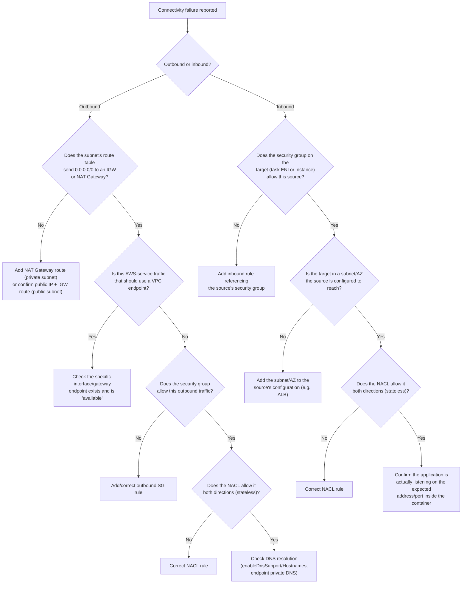

# Runbook: ECS task/instance networking connectivity failure

## 1. Title and purpose

A task or container instance can't reach something it needs — the internet, an AWS service, the ALB,
or another task — and the failure is specifically at the network layer rather than IAM or application
logic. This runbook provides a general connectivity decision tree; the ECR-specific and ALB-specific
variants are covered in their own dedicated runbooks and cross-referenced from here.

## 2. Symptoms

- Connection timeouts, DNS resolution failures, or "no route to host"-style errors in application or
  agent logs.
- `ResourceInitializationError` or `CannotPullContainer` stopped reasons that point at network
  connectivity text specifically (see §9) rather than a permissions message.
- ALB health checks failing in a way that looks like the task is unreachable, not merely unhealthy.

## 3. Possible root causes

Split by direction, since outbound and inbound failures have different likely causes:

**Outbound** (task/instance initiating a connection out):
1. No route to the internet — missing NAT Gateway, or (for a task needing a direct public route) no
   public IP assignment.
2. Missing VPC endpoint for an AWS service that should be reached privately.
3. Security group doesn't allow the outbound traffic (less common, since default security groups allow
   all outbound, but a custom one may not).
4. Network ACL denies the traffic.
5. DNS resolution disabled or misconfigured for the VPC (`enableDnsSupport`/`enableDnsHostnames`), or a
   VPC endpoint created without private DNS enabled.

**Inbound** (something trying to reach the task/instance):
6. Security group doesn't allow the inbound traffic from the actual source (e.g. the ALB's security
   group).
7. The task is in a subnet the inbound source (e.g. the ALB) isn't configured to reach.
8. Network ACL denies the inbound traffic.
9. For `awsvpc` mode specifically: the task's own ENI (not the instance's) has the relevant security
   group — a common point of confusion (`core/patterns/aws/ecs/networking.md` §7).

## 4. Architecture context

Full background: `core/patterns/aws/ecs/networking.md` (VPC layout §3, security groups §4, VPC endpoints
§5, network modes §6, ENIs §7, ALB integration §8). This runbook assumes that architecture and focuses
on the diagnostic sequence for a specific connectivity complaint.

## 5. Prerequisites and required permissions

Read-only IAM permissions: `ec2:DescribeSecurityGroups`, `ec2:DescribeNetworkAcls`,
`ec2:DescribeRouteTables`, `ec2:DescribeVpcEndpoints`, `ec2:DescribeSubnets`, `ec2:DescribeVpcs`,
`ecs:DescribeTasks`, `ecs:DescribeNetworkInterfaces` (via `ec2:DescribeNetworkInterfaces` on the task's
ENI).

## 6. Step-by-step investigation (decision tree)



### Outbound checklist

1. Confirm the subnet's route table (`core/patterns/aws/ecs/networking.md` §3).
2. If the destination is an AWS service, check whether a VPC endpoint should exist for it (§5 of the
   networking doc) rather than assuming NAT Gateway is the only path.
3. Check the security group attached to the actual source of the traffic — the task's own ENI in
   `awsvpc` mode, the instance's ENI in `bridge`/`host` mode.
4. Check Network ACLs on the subnet — remember NACLs are stateless, so both the outbound rule and the
   corresponding inbound (response) rule must allow the traffic.
5. Check DNS: `enableDnsSupport`/`enableDnsHostnames` on the VPC, and "Private DNS name" enabled on any
   relevant interface VPC endpoint.

### Inbound checklist

1. Check the security group on the actual target (task ENI for `awsvpc`, instance ENI otherwise) allows
   the specific source — ideally referenced by the source's security group ID, not a CIDR.
2. Check the source (e.g. an ALB) is configured to reach the target's subnet/AZ at all.
3. Check NACLs, same stateless caveat as above.
4. Only after network-layer checks pass, consider whether the application itself is listening on the
   expected address/port — a passed network check with a still-unreachable app points at the
   application, not the network.

## 7. Read-only AWS CLI commands

```bash
# Route table for a subnet
aws ec2 describe-route-tables --filters "Name=association.subnet-id,Values=<subnet-id>" \
  --query 'RouteTables[0].Routes'
```

```bash
# VPC endpoints present in the VPC
aws ec2 describe-vpc-endpoints --filters "Name=vpc-id,Values=<vpc-id>" \
  --query 'VpcEndpoints[*].{service:ServiceName,type:VpcEndpointType,state:State,privateDns:PrivateDnsEnabled}'
```

```bash
# Security group rules (inbound and outbound)
aws ec2 describe-security-groups --group-ids <security-group-id> \
  --query 'SecurityGroups[0].{inbound:IpPermissions,outbound:IpPermissionsEgress}'
```

```bash
# Network ACL rules for a subnet
aws ec2 describe-network-acls --filters "Name=association.subnet-id,Values=<subnet-id>" \
  --query 'NetworkAcls[0].Entries'
```

```bash
# VPC-level DNS settings
aws ec2 describe-vpc-attribute --vpc-id <vpc-id> --attribute enableDnsSupport
aws ec2 describe-vpc-attribute --vpc-id <vpc-id> --attribute enableDnsHostnames
```

```bash
# The task's own ENI and its security groups (awsvpc mode)
aws ecs describe-tasks --cluster <cluster-name> --tasks <task-arn> \
  --query 'tasks[0].attachments[0].details'
aws ec2 describe-network-interfaces --network-interface-ids <eni-id> \
  --query 'NetworkInterfaces[0].Groups'
```

All commands above are read-only.

## 8. Expected output or relevant output fields

- A private subnet's route table should show a `0.0.0.0/0` route to a `nat-...` gateway (or to specific
  VPC endpoint routes for S3 gateway endpoints); a public subnet's should show `0.0.0.0/0` to an
  `igw-...`.
- `VpcEndpoints[*].state` should be `"available"`, and `PrivateDnsEnabled: true` for interface endpoints
  you expect applications to reach via the standard AWS service hostname.
- Security group `IpPermissions`/`IpPermissionsEgress` entries reference either a CIDR or a
  `UserIdGroupPairs` entry (a security-group-to-security-group reference) — confirm which one actually
  matches your real traffic source.
- NACL `Entries` are evaluated in rule-number order, and the **first** matching rule wins — a low-numbered
  `DENY` can override a later `ALLOW` even if the later rule looks like it should apply.

## 9. How to interpret the results

| Observation | Interpretation |
|---|---|
| No `0.0.0.0/0` route in a private subnet's route table, no NAT Gateway | Root cause 1 — add the NAT Gateway route, or confirm the task actually needs public routing (public subnet + public IP) instead. |
| Route exists, but the destination is an AWS service and no matching VPC endpoint exists | Root cause 2 — see `core/patterns/aws/ecs/networking.md` §5 for exactly which endpoints a given service needs. |
| SG has no matching outbound/inbound rule for the actual traffic | Root cause 3 or 6. |
| NACL has a lower-numbered `DENY` rule matching the traffic before the intended `ALLOW` | Root cause 4 or 8 — NACL rule *ordering* is the key detail, not just presence of an `ALLOW`. |
| VPC endpoint exists but `PrivateDnsEnabled: false` and the application uses the standard AWS hostname | Root cause 5 — the application resolves to the public endpoint instead of the private one, which then fails if there's no internet route. |
| Task's ENI security group ≠ what you assumed (e.g. you checked the instance's SG instead) | Root cause 9 — remember `awsvpc` tasks have their own ENI and SG, separate from the instance. |

## 10. Root-cause identification

State the specific layer and rule: "the private subnet's route table has no NAT Gateway route, so the
task cannot reach `secretsmanager.<region>.amazonaws.com` over the internet, and no VPC endpoint exists
for it either" — not "networking is broken."

## 11. Resolution options

**Documented recommendations only — see §12.**

- Missing NAT Gateway route → add a NAT Gateway and the corresponding route, or add the specific VPC
  endpoint if the destination is an AWS service that supports one (often cheaper and more secure than
  routing through NAT).
- Missing security group rule → add the narrowest rule that allows the actual required traffic,
  preferably referencing a security group ID rather than a CIDR (`core/standards/aws-security.md`).
- NACL ordering problem → renumber or correct the specific rule, remembering NACLs are stateless (both
  directions need an explicit allow).
- DNS/private-DNS misconfiguration → enable private DNS on the relevant VPC endpoint, or correct VPC-level
  DNS attributes.

## 12. Risks and approval requirements

- Route table, security group, and NACL changes are all shared-infrastructure changes affecting more
  than the one task/service you're debugging — require explicit approval per
  `core/standards/change-safety.md`, and consider blast radius (a NACL change affects the whole subnet,
  not just one task).
- Do not open a security group to `0.0.0.0/0` as a diagnostic shortcut "to rule out the security group"
  — this is a real security exposure, not a safe diagnostic step; use VPC Reachability Analyzer or
  careful rule review instead if you need to isolate the cause without widening access.

## 13. Post-resolution verification

Re-run the specific `describe-*` command that revealed the gap (route table, VPC endpoint, security
group, or NACL) to confirm the correction is in place, then confirm the originally-failing task/
application-level symptom is actually resolved — a corrected network configuration should be verified
against the real symptom, not just against the configuration itself.

## 14. Related Brain documentation

- `core/patterns/aws/ecs/networking.md` — full VPC layout, security group, VPC endpoint, and ENI
  reference this runbook's decision tree is built on.
- `core/runbooks/aws/ecs/ecs-ecr-image-pull-failed.md` — the ECR-specific connectivity failure variant.
- `core/runbooks/aws/ecs/ecs-alb-health-check-failed.md` — the ALB-specific inbound connectivity
  variant.
- `core/runbooks/aws/ecs/ec2-instance-not-registering.md` — connectivity failures that prevent agent
  registration specifically.

## 15. Official AWS references

- ECS task networking (EC2): https://docs.aws.amazon.com/AmazonECS/latest/developerguide/task-networking.html
- VPC endpoints (general): https://docs.aws.amazon.com/vpc/latest/privatelink/vpc-endpoints.html
- NAT gateways: https://docs.aws.amazon.com/vpc/latest/userguide/vpc-nat-gateway.html
- Network ACLs: https://docs.aws.amazon.com/vpc/latest/userguide/vpc-network-acls.html
- Security groups: https://docs.aws.amazon.com/vpc/latest/userguide/VPC_SecurityGroups.html

## 16. Verification status

CONFIRMED for VPC/networking mechanics (route tables, NAT Gateway, VPC endpoints, NACL statelessness,
security group behavior) against official AWS VPC documentation. The decision tree's structure is this
Brain's own organization of those confirmed facts, not a verbatim AWS diagram — verify against the
referenced docs for any specific edge case not covered here.
